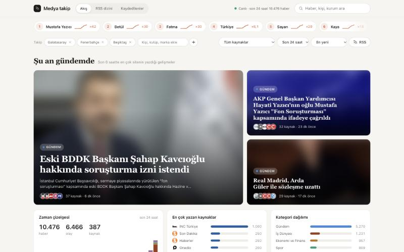
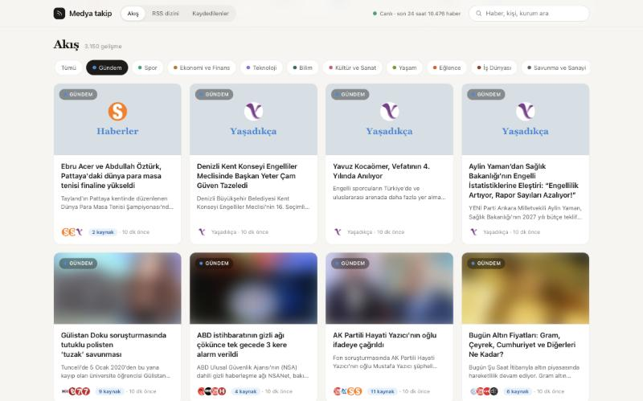
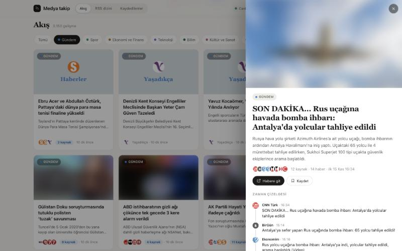
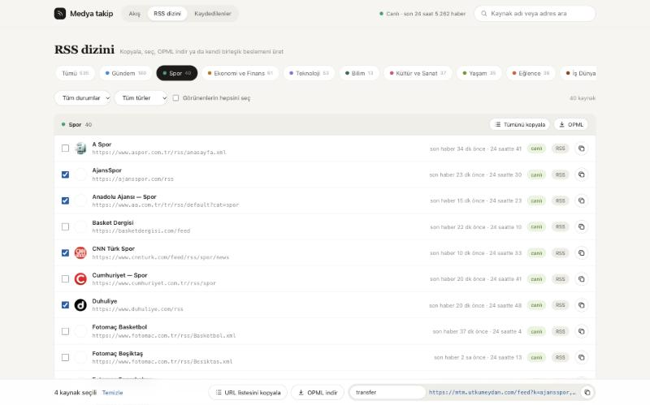
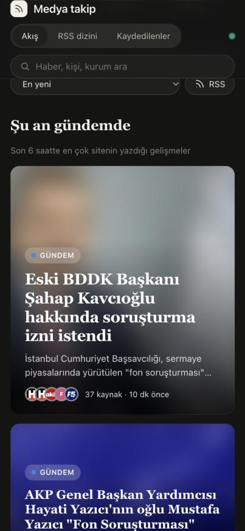

<div align="center">

# Medya Takip Merkezi

**An open-source RSS directory and live media monitoring dashboard for Turkish news sources**

[Türkçe](README.md) · English

[**Live demo → mtm.utkumeydan.com**](https://mtm.utkumeydan.com) &nbsp;·&nbsp; MIT licensed &nbsp;·&nbsp; Self-host with one command



</div>

It polls 564 Turkish news feeds every 10 minutes. Copies of the same story across dozens of sites are grouped into a single **event**, with a timeline showing which outlet published it and when, and rising names are detected as trends. Every feed it collects is shared in a categorized directory: copy one, download many as OPML, or build your own RSS URL from the sources and keywords you pick.

*"Medya Takip Merkezi" means "Media Monitoring Center". The interface is in Turkish.*

## Features

| | |
|---|---|
| **Visual feed** | Stories as image cards; the most widely covered ones lead the "Şu an gündemde" (top stories) section |
| **Event clustering** | One card even when a story runs on 30 sites, with every source and publish time underneath |
| **Trends** | Names of people, organizations and places rising fastest in the last 2 hours versus the previous 24 |
| **Watch list** | Add people, clubs or brands; matching stories are filtered and highlighted |
| **Full-text search** | Turkish-aware: searching "ısınma" also finds "Isınma" |
| **Charts** | Hourly volume, most active sources, category breakdown |
| **RSS directory** | 564 feeds in 14 categories, each with live status and last-published time |
| **Combined feed** | Your chosen sources + keywords = one RSS URL |
| **OPML** | Export selected sources or a whole category to Feedly, Inoreader and other readers |
| **Saved in your browser** | Save, tag and annotate stories; no accounts, no personal data on the server |

<table>
<tr>
<td width="50%"><br><sub>Feed filtered by category</sub></td>
<td width="50%"><br><sub>Event drawer: 12 sources and when each published</sub></td>
</tr>
<tr>
<td width="50%"><br><sub>RSS directory: select, copy, export OPML, build a combined feed</sub></td>
<td width="50%" align="center"><br><sub>Dark theme on a phone</sub></td>
</tr>
</table>

<sub>News photos in the screenshots are blurred for copyright and privacy reasons.</sub>

## Getting started

```bash
git clone https://github.com/utkumeydan/Medya-Takip-Merkezi-RSS.git
cd Medya-Takip-Merkezi-RSS
docker compose up -d
```

Open `http://localhost:8000`. The first crawl takes about a minute.

**Without Docker** (Python 3.10+):

```bash
python3 -m venv .venv
.venv/bin/pip install -r requirements.txt
.venv/bin/uvicorn app.api:app --port 8000
```

The database is a single SQLite file (`data/medya.db`); nothing else to install.

**Coolify, CapRover, etc.:** connect the repository, choose the Dockerfile build pack, port `8000`, and mount persistent storage at `/veri`.

## Configuration

| Variable | Default | Description |
|---|---|---|
| `MT_ARALIK_DK` | `10` | Polling interval (minutes) |
| `MT_SAKLAMA_GUN` | `30` | Days to keep stories |
| `MT_TAM_METIN` | `1` | Fetch full article text for search (`0` disables) |
| `MT_TAM_METIN_GUN` | `7` | Days to keep full text |
| `MT_ESZAMANLI` / `MT_SITE_BASINA` | `20` / `2` | Max concurrent requests / max concurrent requests per site |
| `MT_GENEL_ADRES` | — | Public URL used in combined feeds, e.g. `https://news.example.org` |
| `MT_TOPLAYICI` | `1` | Set `0` to run the API without the crawler (run it separately with `python -m app.toplayici`) |
| `MT_VERI` / `MT_KAYNAKLAR` / `MT_SIMGELER` | `data/medya.db` / `sources/kaynaklar.yaml` / `simgeler/` | File paths |

## Combined feeds and API

All public, no key needed. The examples work on the live demo:

| URL | Returns |
|---|---|
| [`/feed?kat=spor&takip=transfer`](https://mtm.utkumeydan.com/feed?kat=spor&takip=transfer) | Sports stories mentioning "transfer" |
| `/feed?k=ntv-spor-futbol,a-spor&q=derbi` | Stories from selected sources mentioning "derbi" |
| `/feed?takip=Galatasaray,Okan Buruk` | Stories matching any term; one item per event (`tekil=1`) |
| [`/api/opml?kat=gundem,ekonomi`](https://mtm.utkumeydan.com/api/opml?kat=gundem,ekonomi) | OPML file |
| `/api/liste?kat=teknoloji` | Plain-text URL list |
| `/api/kaynaklar`, `/api/kategoriler` | Directory data (JSON) |
| `/api/olaylar?q=&takip=&kat=&kaynak=&saat=24` | Events and their sources |
| `/api/trendler`, `/api/istatistik` | Trends and chart data |

Interactive docs: [`/api/belgeler`](https://mtm.utkumeydan.com/api/belgeler).

## Adding a source

Sources live in [`sources/kaynaklar.yaml`](sources/kaynaklar.yaml). Add an entry and open a pull request:

```yaml
- ad: Örnek Haber — Spor
  url: https://www.ornekhaber.com/rss/spor
  kategori: spor          # category ids are listed at the top of the file
  tur: rss                # rss: the site's own feed · uretilen: generated (Google News query, RSSHub, ...)
  kaynak: [katkı]
```

On pull requests, GitHub Actions checks only the newly added URLs and fails if a feed doesn't work or isn't in Turkish. Run the same check locally:

```bash
.venv/bin/python scripts/kaynak_kontrol.py --canli
```

For sites without RSS, or sites that block server requests, add a Google News query (`site:example.com`) with `tur: uretilen`.

## How it works

- **Crawler:** conditional requests with `ETag` / `Last-Modified`, at most two concurrent requests per site. Detects feeds that stamp every item with the current time and treats them as undated.
- **Event clustering:** titles are normalized for Turkish (apostrophe suffixes removed, words reduced toward their stem) and matched against events from the last 48 hours.
- **Trends:** how often proper names appear in titles in the last 2 hours versus the previous 24; only names seen on at least 4 different sites are listed.
- **Site icons:** stored in the repository (`simgeler/`) as 64 px PNGs, so readers' browsers never call a third-party service.
- **Search:** SQLite FTS5 with Turkish character folding.

## Copyright

The dashboard shows only each story's headline, the short summary from the feed and a link to the original article; images load from the publisher's own server. Full text is kept only on the server, for the search index, for a limited time, and is never republished. Set `MT_TAM_METIN=0` to turn it off on your instance.

## Credits

The initial source list was compiled from these open lists and verified feed by feed: [bakinazik/rss](https://github.com/bakinazik/rss) · [feeder.co Turkey](https://feeder.co/discover/turkey) · [wordpresshabertemasi.com](https://wordpresshabertemasi.com/blog/turkiye-haber-siteleri-rss-adresleri) · [fatihdx/tr-rss-haber-akisi-verisi](https://huggingface.co/datasets/fatihdx/tr-rss-haber-akisi-verisi)

## Author

**İlyas Utku Meydan** · Creative × AI · [utkumeydan.com](https://utkumeydan.com)

If you find it useful, a ⭐ on the repository is appreciated.

## License

[MIT](LICENSE)
