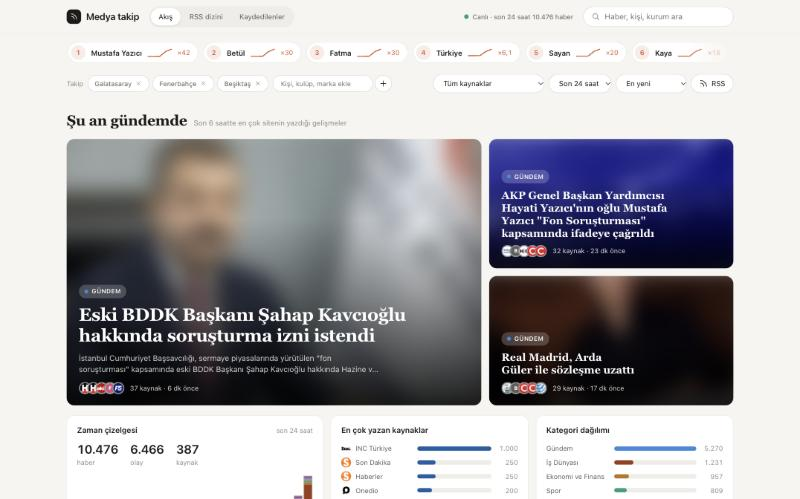
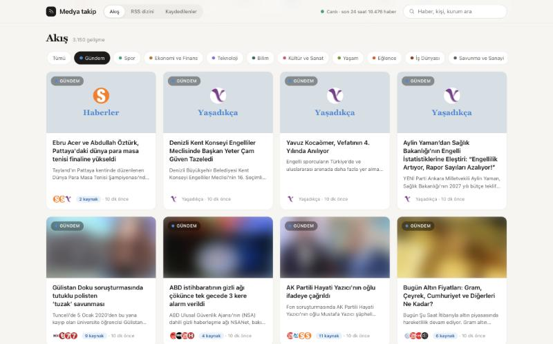
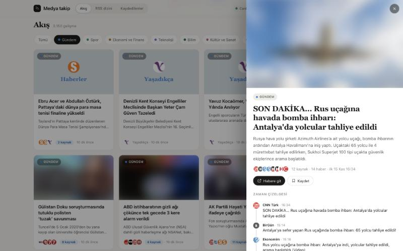
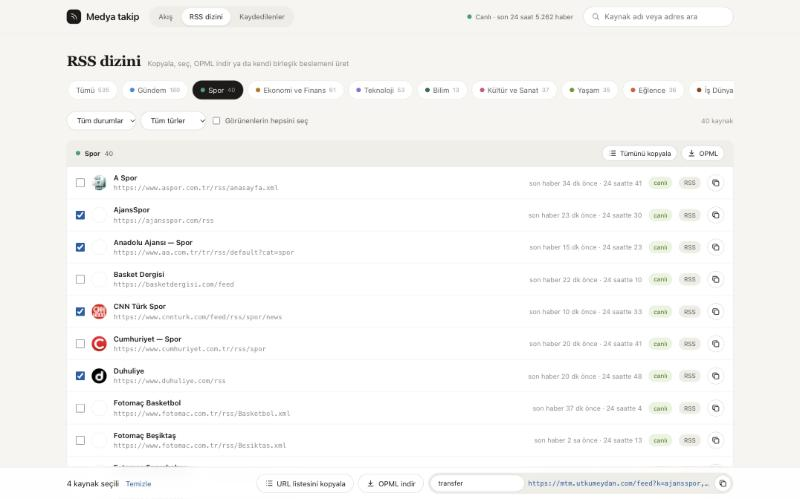
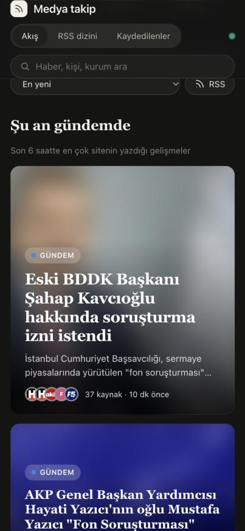

<div align="center">

# Medya Takip Merkezi

**Türkçe haber kaynakları için açık kaynak RSS dizini ve canlı medya takip paneli**

Türkçe · [English](README.en.md)

MIT lisansı &nbsp;·&nbsp; Kendi sunucuna tek komutla kur



</div>

564 Türkçe haber beslemesini 10 dakikada bir tarar. Aynı haberin onlarca sitedeki kopyalarını tek bir **olay** altında toplar, hangi sitenin kaçta yazdığını zaman çizelgesinde gösterir, yükselen adları yakalar. Topladığı beslemeleri kategorili bir dizinde herkesle paylaşır: tek tek kopyala, toplu OPML indir ya da seçtiğin kaynaklardan ve anahtar kelimelerden kendi RSS adresini üret.

## Neler var

| | |
|---|---|
| **Görsel akış** | Haberler görselli kartlarda; en çok sitenin yazdığı gelişmeler "Şu an gündemde" manşetinde |
| **Olay kümeleme** | Aynı haber 30 sitede çıksa da tek kart; altında tüm kaynaklar ve yayın saatleri |
| **Trendler** | Son 2 saatte, önceki 24 saate göre en hızlı yükselen kişi, kurum ve yer adları |
| **Takip listesi** | Kişi, kulüp, marka ekle; geçtiği haberler süzülür ve işaretlenir |
| **Tam metin arama** | Türkçe karakterleri tanır: "ısınma" araması "Isınma"yı da bulur |
| **Grafikler** | Saatlik haber yoğunluğu, en çok yazan kaynaklar, kategori dağılımı |
| **RSS dizini** | 564 besleme, 14 kategori; her birinin canlılık durumu ve son haber saati |
| **Birleşik besleme** | Seçtiğin kaynaklar + anahtar kelimeler = tek RSS adresi |
| **OPML** | Seçili kaynakları ya da bir kategorinin tamamını Feedly, Inoreader vb. okuyuculara aktar |
| **Kayıtlar tarayıcıda** | Kaydet, etiketle, not al; üyelik yok, sunucuda kişisel veri yok |

<table>
<tr>
<td width="50%"><br><sub>Kategoriye göre süzülen görselli akış</sub></td>
<td width="50%"><br><sub>Olay çekmecesi: 12 kaynak, kim kaçta yazdı</sub></td>
</tr>
<tr>
<td width="50%"><br><sub>RSS dizini: seç, kopyala, OPML indir, birleşik besleme üret</sub></td>
<td width="50%" align="center"><br><sub>Telefonda koyu tema</sub></td>
</tr>
</table>

<sub>Ekran görüntülerindeki haber fotoğrafları telif ve kişi hakları nedeniyle bulanıklaştırılmıştır.</sub>

## Kurulum

```bash
git clone https://github.com/utkumeydan/Medya-Takip-Merkezi-RSS.git
cd Medya-Takip-Merkezi-RSS
docker compose up -d
```

Panel `http://localhost:8000` adresinde açılır. İlk tarama yaklaşık bir dakika sürer.

**Docker olmadan** (Python 3.10+):

```bash
python3 -m venv .venv
.venv/bin/pip install -r requirements.txt
.venv/bin/uvicorn app.api:app --port 8000
```

Veritabanı tek bir SQLite dosyasıdır (`data/medya.db`), ek kurulum gerekmez.

**Coolify, CapRover vb.:** Depoyu bağla, derleme türü olarak Dockerfile'ı seç, port `8000`, kalıcı alanı `/veri` yoluna bağla.

## Ayarlar

| Değişken | Varsayılan | Açıklama |
|---|---|---|
| `MT_ARALIK_DK` | `10` | Tarama aralığı (dakika) |
| `MT_SAKLAMA_GUN` | `30` | Haberlerin tutulacağı gün |
| `MT_TAM_METIN` | `1` | Yeni haberlerin tam metnini arama için çek (`0` kapatır) |
| `MT_TAM_METIN_GUN` | `7` | Tam metnin tutulacağı gün |
| `MT_ESZAMANLI` / `MT_SITE_BASINA` | `20` / `2` | Aynı anda en fazla istek / aynı siteye en fazla istek |
| `MT_GENEL_ADRES` | — | Birleşik beslemelerde görünecek adres, ör. `https://medya.ornek.org` |
| `MT_TOPLAYICI` | `1` | `0` yaparsan API toplayıcıyı başlatmaz (ayrı çalıştırmak için `python -m app.toplayici`) |
| `MT_VERI` / `MT_KAYNAKLAR` / `MT_SIMGELER` | `data/medya.db` / `sources/kaynaklar.yaml` / `simgeler/` | Dosya yolları |

## Birleşik besleme ve API

Hepsi herkese açık, anahtar gerekmez:

| Adres | Ne verir |
|---|---|
| `/feed?kat=spor&takip=transfer` | Spor kategorisinde "transfer" geçen haberler |
| `/feed?k=ntv-spor-futbol,a-spor&q=derbi` | Seçili kaynaklarda "derbi" geçenler |
| `/feed?takip=Galatasaray,Okan Buruk` | Terimlerden biri geçen haberler; her olaydan yalnız ilk haber (`tekil=1`) |
| `/api/opml?kat=gundem,ekonomi` | OPML dosyası |
| `/api/liste?kat=teknoloji` | Düz metin URL listesi |
| `/api/kaynaklar`, `/api/kategoriler` | Dizin verisi (JSON) |
| `/api/olaylar?q=&takip=&kat=&kaynak=&saat=24` | Olaylar ve kaynakları |
| `/api/trendler`, `/api/istatistik` | Trendler ve grafik verisi |

Tüm uç noktalar: `/api/belgeler`.

## Kaynak eklemek

Kaynaklar [`sources/kaynaklar.yaml`](sources/kaynaklar.yaml) dosyasında. Listeye bir giriş ekleyip PR gönder:

```yaml
- ad: Örnek Haber — Spor
  url: https://www.ornekhaber.com/rss/spor
  kategori: spor          # kategoriler dosyanın başında
  tur: rss                # rss: sitenin kendi beslemesi · uretilen: Google Haberler sorgusu, RSSHub vb.
  kaynak: [katkı]
```

PR açıldığında GitHub Actions yalnızca yeni eklenen adresleri dener; besleme çalışmıyorsa ya da içerik Türkçe değilse kontrol başarısız olur. Yerelde aynı denetim:

```bash
.venv/bin/python scripts/kaynak_kontrol.py --canli
```

RSS'i olmayan ya da sunucu isteklerini engelleyen siteler için `tur: uretilen` ile Google Haberler sorgusu (`site:alanadi.com`) eklenebilir.

## Nasıl çalışır

- **Toplayıcı:** Beslemeleri `ETag` / `Last-Modified` ile koşullu çeker, aynı siteye aynı anda en fazla iki istek gönderir. Her haberine o anın tarihini yazan beslemeleri tanır ve tarihsiz sayar.
- **Olay kümeleme:** Başlıklar Türkçeye göre sadeleştirilir (kesme ekleri atılır, sözcükler köke yaklaştırılır) ve son 48 saatteki olaylarla benzerliğe göre eşleştirilir.
- **Trendler:** Başlıklardaki özel adların son 2 saatteki geçme hızı önceki 24 saatle karşılaştırılır; en az 4 farklı sitede geçenler listelenir.
- **Simgeler:** Site simgeleri proje içinde (`simgeler/`) 64 piksellik PNG olarak tutulur; okuyucunun tarayıcısı hiçbir dış servise istek atmaz.
- **Arama:** SQLite FTS5, Türkçe karakter katlamalı.

## Telif

Panel haberlerin yalnızca başlığını, beslemedeki kısa özetini ve orijinal habere bağlantıyı gösterir; görseller kaynağın kendi sunucusundan yüklenir. Tam metin yalnızca sunucuda, arama dizini için ve sınırlı süre tutulur, hiçbir yerde yeniden yayımlanmaz. Kendi kurulumunda kapatmak için `MT_TAM_METIN=0`.

## Teşekkür

İlk kaynak listesi şu açık listelerden derlenip tek tek doğrulandı: [bakinazik/rss](https://github.com/bakinazik/rss) · [feeder.co Türkiye](https://feeder.co/discover/turkey) · [wordpresshabertemasi.com](https://wordpresshabertemasi.com/blog/turkiye-haber-siteleri-rss-adresleri) · [fatihdx/tr-rss-haber-akisi-verisi](https://huggingface.co/datasets/fatihdx/tr-rss-haber-akisi-verisi)

## Geliştiren

**İlyas Utku Meydan** · Creative × AI · [utkumeydan.com](https://utkumeydan.com)

Projeyi beğendiysen depoya ⭐ bırakabilirsin.

## Lisans

[MIT](LICENSE)
